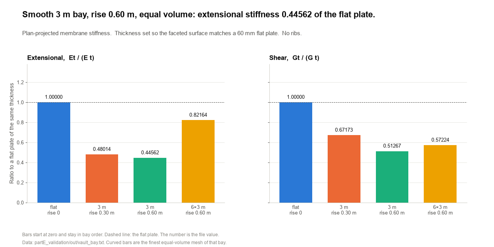

# Seismic shell floors

In-plane stiffness of one vault bay, the diaphragm ratio of that stiffness on the anchor frame, and gravity on the same bay. The generator reproduces the recorded bay. The building loop and the search are not in this record.

[Key finding](#key-finding) | [Check it](#check-it-in-three-steps) | [Method](#method) | [Figures](#figures) | [Validation](#validation) | [Brief](brief.md) | [About](#about)

<picture>
  <source media="(prefers-color-scheme: dark)" srcset="docs/img/hero_dark.png">
  
</picture>

| Rise 0.60 m, equal volume | Smooth shell | One rib cross | alpha* at L/D 0.3 | alpha* at L/D 2 |
|---|---:|---:|---:|---:|
| Et/(E T), and alpha* on seven equal bays | 0.40763 | 0.38984 | 54.651 | 495.420 |

## Key finding

*Question:* at equal concrete volume, how much of a flat plate's in-plane stiffness does one vault bay keep, and does one rib cross give any of it back? Hypothesis H1 in [brief.md](brief.md).

> One rib cross stays below the smooth shell. At rise 0.60 m, Et/(E T) is 0.38984 on the cross and 0.40763 on the smooth shell. The flat plate is 1.00000.

| Hypothesis | Verdict | Key numbers |
|---|---|---|
| H1. Flat-plate in-plane stiffness is an upper bound for the curved, ribbed floor of equal volume | Open. The smooth shell, the cross, the diagonals and both stress-line spacings are below the flat plate. The cross is below the smooth shell. None of these layouts closes H1 | Rise 0.30 m: diagonals 0.44408 and 0.65435; stress lines 0.46328 and 0.64944. Rise 0.60 m, 21×21: smooth 0.40763 and 0.46892; cross 0.38984 and 0.45189; diagonals 0.39834 and 0.47168; stress lines 0.375 m, 0.40744 and 0.46840; stress lines 0.75 m, 0.41394 and 0.46365 |

| Recorded | Not in this record |
|---|---|
| Rungs 1 and 2. Smooth bay. One rib cross. Diagonals at rise 0.30 m and 0.60 m. Principal-stress ribs at 0.375 m and 0.75 m, and at rise 0.30 m. Corner tension on the smooth bay, the cross, the diagonals and the recorded stress-line ribs. A joint strip. Timoshenko K_d for the flat plate. alpha* on the anchor frame. Gravity on the 3 m bay | The X-strut within 5 %, the building loop, NSGA-II |

The figure is the equal-volume comparison, Et/(E T) and Gt/(G T), with T = 60 mm. [partE_validation/out/vault_rib.txt](partE_validation/out/vault_rib.txt). Plotted values: [docs/img/hero.json](docs/img/hero.json).

| Case | Mesh | t shell mm | t rib mm | Area/plan | Et/(E T) | Gt/(G T) | Et/(E t*) |
|---|---|---:|---:|---:|---:|---:|---:|
| Smooth, rise 0 | 21×21 | 60.0 | 60.0 | 1.0000 | 1.00000 | 1.00000 | 1.00000 |
| Cross, rise 0 | 21×21 | 50.0 | 157.6 | 1.0000 | 0.94989 | 0.89831 | |
| Smooth, rise 0.30 m | 21×21 | 58.6 | 58.6 | 1.0243 | 0.46875 | 0.65578 | 0.48013 |
| Cross, rise 0.30 m | 21×21 | 50.0 | 142.2 | 1.0243 | 0.43480 | 0.60185 | |
| Smooth, rise 0.60 m | 21×21 | 54.9 | 54.9 | 1.0931 | 0.40763 | 0.46892 | 0.44560 |
| Cross, rise 0.60 m | 21×21 | 50.0 | 102.5 | 1.0931 | 0.38984 | 0.45189 | |

At rise 0.60 m the cross is 0.95637 of the smooth shell in extension and 0.96369 in shear. At rise 0.30 m those ratios are 0.92757 and 0.91777. On the flat plate they are 0.94989 and 0.89831.

Two diagonals on the same rise and the same volume, shell 50 mm, rib 104.77 mm, 41 elements: Et/(E T) 0.39834 and Gt/(G T) 0.47168. [partB_generator/out/diagonal_bay.txt](partB_generator/out/diagonal_bay.txt). The generator reproduces the recorded smooth shell and the cross to 2.91e-06. [partB_generator/out/reproduce_bay.txt](partB_generator/out/reproduce_bay.txt). *Author to confirm the diagonals.*

At rise 0.30 m the same diagonals, 41 elements, rib 143.33 mm, give Et/(E T) 0.44408 and Gt/(G T) 0.65435. Those are 0.02467 and 0.00143 below the smooth shell at that rise, 0.46875 and 0.65578. [partB_generator/out/diagonal_rise030.txt](partB_generator/out/diagonal_rise030.txt). *Author to confirm the rise.*

Stress lines at that rise, spacing 0.375 m, cover 232 of 441 elements with a rib of 66.29 mm. Et/(E T) 0.46328 and Gt/(G T) 0.64944, which are 0.00547 and 0.00634 below the smooth shell. [partB_generator/out/stress_rib_rise030.txt](partB_generator/out/stress_rib_rise030.txt). *Author to confirm the rise.*

Principal-stress ribs follow both families of the gravity membrane stress on that smooth bay. The spacing is 0.375 m. The strip is half an element pitch. 24 lines cover 236 of 441 elements, and the rib is 59.16 mm on a 50 mm shell. Et/(E T) 0.40744 and Gt/(G T) 0.46840, which are 0.00019 and 0.00052 below the smooth shell. [partB_generator/out/stress_rib.txt](partB_generator/out/stress_rib.txt). Doubling the spacing to 0.75 m leaves 12 lines, 128 elements and a rib of 66.65 mm. Et/(E T) 0.41394 is 0.00631 above the smooth shell, and Gt/(G T) 0.46365 is 0.00527 below it. [partB_generator/out/stress_rib_075.txt](partB_generator/out/stress_rib_075.txt). Both spacings stay under the flat plate. *Author to confirm the field, the axes and the spacings.*

The earlier mesh table uses another ratio. Et/(E t) there divides by the thickness in the row, not by 60 mm. For the 16×16 equal-volume row at rise 0.60 m, 0.44562 / 1.0930 = 0.40770, beside 0.40763 on the 21×21 mesh. [partE_validation/out/vault_bay.txt](partE_validation/out/vault_bay.txt).

<details>
<summary>Mesh record, including the 6×3 m bay</summary>

| Case | Mesh | t mm | Area/plan | Et/(E t) | Gt/(G t) |
|---|---|---:|---:|---:|---:|
| Square 3 m, rise 0 | 8×8 | 60.0 | 1.0000 | 1.00000 | 1.00000 |
| 3×3 m, rise 0.30 m, equal t | 8×8 | 60.0 | 1.0240 | 0.48155 | 0.67712 |
| 3×3 m, rise 0.30 m, equal t | 16×16 | 60.0 | 1.0242 | 0.48132 | 0.67614 |
| 3×3 m, rise 0.30 m, equal V | 16×16 | 58.6 | 1.0242 | 0.48014 | 0.67173 |
| 3×3 m, rise 0.60 m, equal t | 4×4 | 60.0 | 1.0886 | 0.45713 | 0.57026 |
| 3×3 m, rise 0.60 m, equal t | 8×8 | 60.0 | 1.0921 | 0.44789 | 0.52279 |
| 3×3 m, rise 0.60 m, equal V | 8×8 | 54.9 | 1.0921 | 0.44602 | 0.51455 |
| 3×3 m, rise 0.60 m, equal t | 12×12 | 60.0 | 1.0928 | 0.44758 | 0.52133 |
| 3×3 m, rise 0.60 m, equal t | 16×16 | 60.0 | 1.0930 | 0.44752 | 0.52114 |
| 3×3 m, rise 0.60 m, equal V | 16×16 | 54.9 | 1.0930 | 0.44562 | 0.51267 |
| 6×3 m, rise 0.60 m, equal t | 8×4 | 60.0 | 1.0565 | 0.82641 | 0.59070 |
| 6×3 m, rise 0.60 m, equal t | 16×8 | 60.0 | 1.0583 | 0.82359 | 0.57860 |
| 6×3 m, rise 0.60 m, equal V | 16×8 | 56.7 | 1.0583 | 0.82164 | 0.57224 |

Rise zero against the flat cell in the same file: Et 1.684e-06 %, Gt 1.155e-12 %. The limit is 0.1 %.

| Mesh change, equal thickness | Et/(E t) | Gt/(G t) |
|---|---|---|
| 3 m, rise 0.30 m, 8×8 to 16×16 | 0.48155 to 0.48132 | 0.67712 to 0.67614 |
| 3 m, rise 0.60 m, 12×12 to 16×16 | 0.44758 to 0.44752 | 0.52133 to 0.52114 |
| 6×3 m, rise 0.60 m, 8×4 to 16×8 | 0.82641 to 0.82359 | 0.59070 to 0.57860 |

The 6×3 m shear ratio still moves between those two meshes. The long direction of that bay is flatter than the square at the same rise, and its equal-volume Et/(E t) is 0.82164.

</details>

| Limit | Record |
|---|---|
| Surface | z = f sin(π x / Lx) sin(π y / Ly). *Author to confirm the surface and the rises 0.30 m and 0.60 m.* |
| Ribs | One cross on the centreline. Width 3/21 m. Shell 50 mm. Rib thickness set to the 60 mm volume. *Author to confirm the cross, the width and the 50 mm shell.* |
| Comparison | Et/(E T) and Gt/(G T), T = 60 mm. The mesh table also prints Et/(E t) of the row thickness |
| Analysis | Linear static S8R for the cell. Gravity adds self-weight and a linear buckling factor. No imperfection knockdown |
| Area | Faceted corner triangles over the plan. The mid-side curve is not counted |

> H2 is not supported on this model. alpha* of seven equal bays is 54.651 at L/D 0.3 and 495.420 at L/D 2. On the anchor bays the uncracked excess at rise 0.60 m is 0.1012 (smooth) and 0.1045 (cross). The 10 % line is the NOTE to EN 1998-1 4.3.1(4), author's copy.

| Layout | L/D | alpha* |
|---|---:|---:|
| Seven equal bays | 0.300 | 54.651 |
| Seven equal bays | 0.500 | 97.479 |
| Seven equal bays | 1.000 | 247.188 |
| Seven equal bays | 2.000 | 495.420 |
| Anchor bays | 0.314 | 63.052 |

| Cell on the anchor bays | Et/(E T) | Gt/(G T) | alpha | Uncracked excess | Half Et, Gt: alpha | Half: excess |
|---|---:|---:|---:|---:|---:|---:|
| Smooth, rise 0 | 1.00000 | 1.00000 | 142.82 | 0.0509 | 71.41 | 0.0908 |
| Cross, rise 0 | 0.94989 | 0.89831 | 128.58 | 0.0545 | 64.29 | 0.0965 |
| Smooth, rise 0.30 m | 0.46875 | 0.65578 | 92.15 | 0.0854 | 46.07 | 0.1417 |
| Cross, rise 0.30 m | 0.43480 | 0.60185 | 84.62 | 0.0908 | 42.31 | 0.1494 |
| Smooth, rise 0.60 m | 0.40763 | 0.46892 | 66.56 | 0.1012 | 33.28 | 0.1648 |
| Cross, rise 0.60 m | 0.38984 | 0.45189 | 64.12 | 0.1045 | 32.06 | 0.1692 |

K_f of the ground storey, beam inertia factor 2.0, is 1.174970×10⁸ N/m. Two frames give alpha* 19.9956, against 20 from the definition of K_d. The beam element is −0.003 % from the closed deflection. [partE_validation/out/alpha_star.txt](partE_validation/out/alpha_star.txt). The half is 4.3.1(7). *Author to confirm the clause, the storey, and the half.*

| Gravity, 21×21, pinned boundary | Crown w, mm | Lowest positive factor | Crown sxx, Pa |
|---|---:|---:|---|
| Flat, 60 mm | −0.7956 | 25122.1 | +5.701984×10⁵ and −5.701984×10⁵ |
| Smooth, rise 0.60 m | −0.0022 | 4933.37 | −1.941393×10⁴ and −1.684599×10⁴ |
| Cross, rise 0.60 m | −0.0024 | 5210.6 | −1.867630×10⁴ and −1.325382×10⁴ |
| Diagonals, rise 0.60 m | −0.0028 | 4272.83 | −1.478991×10⁴ and −1.460445×10⁴ |
| Smooth, rise 0.30 m | −0.006964 | 2319.99 | −5.014637×10⁴ and −2.806953×10⁴ |
| Cross, rise 0.30 m | −0.0095 | 2789 | −4.546519×10⁴ and −3.102803×10⁴ |
| Diagonals, rise 0.30 m | −0.0093 | 1856.27 | −3.709125×10⁴ and −2.155468×10⁴ |
| Stress lines, rise 0.30 m, 0.375 m | −0.0067 | 2405.68 | −5.470485×10⁴ and −2.852846×10⁴ |
| Stress lines, 0.375 m | −0.0022 | 5012.74 | −2.022574×10⁴ and −1.691824×10⁴ |
| Stress lines, 0.75 m | −0.0022 | 5383.24 | −1.962041×10⁴ and −1.705144×10⁴ |

The first three rows are [partE_validation/out/gravity_bay.txt](partE_validation/out/gravity_bay.txt). That file has no rise 0.30 m row. The diagonal rows are [partB_generator/out/diagonal_bay.txt](partB_generator/out/diagonal_bay.txt) and [diagonal_rise030.txt](partB_generator/out/diagonal_rise030.txt). The stress-line rows are [partB_generator/out/stress_rib.txt](partB_generator/out/stress_rib.txt), [stress_rib_075.txt](partB_generator/out/stress_rib_075.txt) and [stress_rib_rise030.txt](partB_generator/out/stress_rib_rise030.txt). The smooth crown in that rise 0.30 m print is −0.006964 mm. The smooth factor at that rise is 2319.99 and the cross factor is 2789, with cross crown −0.0095 mm. [partE_validation/out/gravity_rise030.txt](partE_validation/out/gravity_rise030.txt). The smooth faces in the table are the stress print. On the smooth rise of 0.60 m, 24 of 441 elements have one tensile membrane principal, all at the four corners. The largest is 6.950346×10³ Pa. [partB_generator/out/compression_smooth.txt](partB_generator/out/compression_smooth.txt). On the smooth rise of 0.30 m, 32 of 441 elements have one tensile principal. Twenty lie within one element pitch of the plan boundary and the other twelve stay in the four corner clusters. The farthest tensile centroid is 0.4165 m from a plan corner. The largest is 9.369478×10³ Pa. [partB_generator/out/compression_smooth_rise030.txt](partB_generator/out/compression_smooth_rise030.txt). On the cross the counts are the same: 32 at rise 0.30 m and 24 at rise 0.60 m. The largest principals are 1.031277×10⁴ Pa and 7.047014×10³ Pa. The farthest tensile centroids are 0.4165 m and 0.3642 m from a plan corner. [compression_cross_rise030.txt](partB_generator/out/compression_cross_rise030.txt), [compression_cross_rise060.txt](partB_generator/out/compression_cross_rise060.txt). On the diagonals the count is 24 at both rises. The largest principals are 5.770915×10³ Pa and 5.506480×10³ Pa. The farthest tensile centroid is 0.3642 m from a plan corner. [compression_diagonal_rise030.txt](partB_generator/out/compression_diagonal_rise030.txt), [compression_diagonal_rise060.txt](partB_generator/out/compression_diagonal_rise060.txt). On the stress lines the count matches the smooth bay: 32 of 441 at rise 0.30 m and spacing 0.375 m, and 24 of 441 at rise 0.60 m for both spacings. None has both principals tensile. At rise 0.60 m, 20 lie within one element pitch of the plan boundary and the other four are one element further in, at the four corners. At rise 0.30 m, 20 lie within one pitch and the other 12 stay in the four corner clusters. The farthest tensile centroids are 0.4165 m and 0.3642 m from a plan corner. The largest principals are 1.020770×10⁴ Pa, 6.630235×10³ Pa and 6.193632×10³ Pa. [compression_stress_rise030_s375.txt](partB_generator/out/compression_stress_rise030_s375.txt), [compression_stress_rise060_s375.txt](partB_generator/out/compression_stress_rise060_s375.txt), [compression_stress_rise060_s750.txt](partB_generator/out/compression_stress_rise060_s750.txt). Rotations on the boundary are free. Density 2500 kg/m³. No knockdown. *Author to confirm the support, the density and the tension check.*

| Joint factor 0.1, flat 60 mm | Strip width | Et / continuous |
|---|---:|---:|
| 9×9 | 0.333 m | 0.58615 |
| 15×15 | 0.200 m | 0.68666 |

Factor 1 is the continuous floor. [partE_validation/out/joint_stiffness.txt](partE_validation/out/joint_stiffness.txt). *Author to confirm the strip.*

## Check it in three steps

The `research` conda env is shared. `cecore` comes from `ComputationalEngineering/cecore` and is not inside this repository. CalculiX 2.23 is required for the three record scripts. On PowerShell, set `$env:PYTHONPATH = "."` before each script.

**1. Environment**

```bash
conda activate research
```

**2. Record** (from this folder)

```bash
PYTHONPATH=. python partE_validation/rung1_unit_cell.py
PYTHONPATH=. python partE_validation/rung2_deep_beam.py
PYTHONPATH=. python partE_validation/vault_bay.py
PYTHONPATH=. python partE_validation/vault_rib.py
PYTHONPATH=. python partE_validation/joint_stiffness.py
PYTHONPATH=. python partE_validation/xstrut_check.py
PYTHONPATH=. python partE_validation/rung4_storey.py
PYTHONPATH=. python partE_validation/rung4_cross.py
PYTHONPATH=. python partE_validation/rung4_layouts.py
PYTHONPATH=. python partE_validation/gravity_bay.py
PYTHONPATH=. python partE_validation/alpha_star.py
```

`alpha_star.py` imports the ShellBench anchor frame and OpenSees. The number it prints for K_f is the one in the table above. `check_alpha_record.py` recomputes alpha and alpha* from that printed K_f, and it checks the six cell ratios against `vault_rib.txt`. It does not call OpenSees and it does not write the file. `check_tension_record.py` reads the nine compression prints and checks that the README and the preprint name each tensile count and each largest principal, that each largest principal stays in that layout's sentences, and that the methods log names each farthest centroid, each smallest principal, and each principal further than one element pitch from the plan boundary. It does not write those files. `check_joint_record.py` reads `joint_stiffness.txt`. It checks that Et/cont and Gt/cont are that row divided by the factor-1 row, and that the README, the preprint and the methods log name the printed flat factor-0.1 ratios with their strip widths. It does not call CalculiX and it does not write the file. `check_gravity_record.py` reads the gravity, diagonal and stress-line prints. It checks the printed buckling factor against the first eigenvalue in that print, that the README and the preprint name each crown, factor and face pair on the same table row, that a named peak deflection is the printed largest |w|, and that a gravity thickness rounded to tenths is the rib-file thickness. The gravity print states rho = 2500 kg/m3 and g = 9.81 m/s2. It does not call CalculiX and it does not write those files. `check_layout_deltas.py` reads `vault_rib.txt` and the diagonal and stress-line stiffness lines. It checks each cross ratio, each stated gap, and the printed line and element counts against those files. Each smooth and cross Et stays on the same table row as its Gt. The H1 row keeps those stiffnesses and stays open. The key finding states the recorded rise 0.60 m ratios. The preprint stiffness table keeps each layout's Et with its Gt. It does not call CalculiX and it does not write those files. `check_alpha_docs.py` reads `alpha_star.txt` and checks that the README, the preprint and the methods log name the printed alpha* rows and the quoted cell excesses. The preprint and the methods log state the anchor spans and the depth from `alpha_star.py`. The README table keeps each cell's Et, Gt, alpha, excess and cracked pair on one row. It does not call OpenSees and it does not write the file. `check_vault_bay_record.py` reads `vault_bay.txt`. It checks that the README names each mesh row, that each of the thirteen rows keeps its thickness, area/plan, Et and Gt together, and that 0.44562 / 1.0930 is the printed five-decimal conversion to the 60 mm plate. The named prints state E = 3.3e+10 Pa and nu = 0.2, and the README and the preprint state C30/37, E = 33 GPa and nu = 0.2. It does not call CalculiX and it does not write the file. `check_reproduce_record.py` reads `reproduce_bay.txt`. The printed generator columns match `vault_rib.txt`, and the README and the methods log name the unrounded difference. The README keeps the generator in the record, and Part C and Part D stay not started. Those folders contain only .gitkeep. The X-strut within 5 %, the building loop and NSGA-II stay out of the record, and H1 stays open. It does not call CalculiX and it does not write those files.

`rung4_layouts.py` reads `partB_generator/out/smooth_gravity_stress.dat` and `smooth_gravity_stress_030.dat` for the stress-line rows. Those files are the gravity prints. The script does not rewrite them. The commands above rewrite their result files. The copies in this repository are the record.

```bash
PYTHONPATH=. python partE_validation/check_rung4_record.py
PYTHONPATH=. python partE_validation/check_alpha_record.py
PYTHONPATH=. python partE_validation/check_tension_record.py
PYTHONPATH=. python partE_validation/check_joint_record.py
PYTHONPATH=. python partE_validation/check_gravity_record.py
PYTHONPATH=. python partE_validation/check_layout_deltas.py
PYTHONPATH=. python partE_validation/check_alpha_docs.py
PYTHONPATH=. python partE_validation/check_vault_bay_record.py
PYTHONPATH=. python partE_validation/check_reproduce_record.py
PYTHONPATH=. python partE_validation/check_stress_field.py
PYTHONPATH=. python partE_validation/check_suite.py
```

`check_rung4_record.py` reads `rung1_unit_cell.txt`, `rung2_deep_beam.txt`, `rung4_layouts.txt`, `rung4_cross.txt`, `rung4_storey.txt`, `rung4_wlock.txt`, `xstrut_check.txt` and `docs/img/hero.json`. It recomputes the exact flat stiffness, the rung-2 Timoshenko column, the rung-4 Timoshenko column, and the two X-strut percentages. It checks the five hero rows against `vault_rib.txt`. The w-lock print stays a separate fail and does not replace the recorded rung 4. Its bend shares match the bending term of the same formula. The 1 m panel stays with 9.83 % and the 0.5 m panel stays with 12.74 %. The seven other layout errors stay in the file order. Only the rise 0.30 m cross passes the 5 % limit. The 12×12 summary stays a fail at 15.80 %, and the X-strut summary stays a fail at 12.74 %. Those beam prints state q = 1e+04 N/m, and the preprint and the methods log state k = 5/6. It does not call CalculiX and it does not write those files.

`check_stress_field.py` reads `smooth_gravity_stress.dat` and `smooth_gravity_stress_030.dat`. Element 221, points 1 to 4, matches one crown face in the stress-line file, and points 5 to 8 match the other. The 0.75 m print names the same rise 0.60 m gate. The two in-plane stresses on each point agree. It does not call CalculiX and it does not write those files.

`check_suite.py` runs those printed-record checks. The README names each one. The 76 relative links in the Markdown files resolve inside this repository. It does not call CalculiX or OpenSees and it does not write the prints.

**3. Figures**

```bash
python scripts/readme_hero.py
python scripts/alpha_fig.py
```

Those two scripts write `docs/img/hero_light.png`, `docs/img/hero_dark.png`, `docs/img/hero.json`, `docs/img/alpha_light.png` and `docs/img/alpha_dark.png`. Running them replaces those files. The copies in this repository are the record.

## Method

$$
z = f \sin(\pi x / L_x)\sin(\pi y / L_y)
$$

$$
t^{*} = t\,\frac{L_x L_y}{A_{\text{faceted}}}
\qquad
(Et)_{\text{eq}} = A_{00} - A_{01}^{2}/A_{11}
\qquad
(Gt)_{\text{eq}} = A_{22}
$$

| Item | Value |
|---|---|
| Plan | 3 × 3 m, and one 6 × 3 m bay. The 3 m cell is the rung-1 plan |
| Material | C30/37, E = 33 GPa, ν = 0.2, reference thickness 60 mm |
| Mesh | Structured S8R, the rung-1 grid lifted onto the surface. Gmsh is not used |
| Boundary | Affine u and v, and w = 0, on the plan boundary only. Interior nodes are free |
| Strain | Three states, magnitude 1×10⁻⁴. Resultants from the virtual work of the plan reactions, divided by the plan area |
| Equal volume | t* above, so the faceted surface matches the 60 mm plate. Equal thickness is reported beside it |
| Ribs | Orthogonal cross, one element wide, on the 21×21 mesh. Two shell sections |
| Code | [partA_mechanics/plate_fe.py](partA_mechanics/plate_fe.py), `shell_membrane_stiffness` |

A rise of zero uses the same grid as `membrane_stiffness` and must agree within 0.1 %. Curved rows have no pass mark. They are the record.

## Figures

Drawn from `partE_validation/out/vault_rib.txt` by [scripts/readme_hero.py](scripts/readme_hero.py). The number on the figure is the file value.

| Equal-volume stiffness | |
|---|---|
|  | |
| Equal-volume rows of the smooth shell and one rib cross. Source: `partE_validation/out/vault_rib.txt`. | |

| alpha* | |
|---|---|
|  | |
| Drawn by `scripts/alpha_fig.py` from `partE_validation/out/alpha_star.txt`. | |

## Validation

| Check | Limit | Result | File |
|---|---|---|---|
| Rung 1. Flat cell against exact E t, G t | 1 % | PASS. Worst error 1.62e-06 % | [partE_validation/out/rung1_unit_cell.txt](partE_validation/out/rung1_unit_cell.txt) |
| Rung 2. Deep beam against Timoshenko | 2 % | PASS. Worst error 0.21 %. Shear share 3.5 % to 36.5 % | [partE_validation/out/rung2_deep_beam.txt](partE_validation/out/rung2_deep_beam.txt) |
| Rise zero against the flat cell | 0.1 % | PASS. Et 1.684e-06 %, Gt 1.155e-12 % | [partE_validation/out/vault_bay.txt](partE_validation/out/vault_bay.txt) |
| Smooth rise 0 on the rib mesh | exact E T | 1.00000 and 1.00000. The cross has no pass mark | [partE_validation/out/vault_rib.txt](partE_validation/out/vault_rib.txt) |
| Rung 4. Shell deep beam against its own Et, Gt, 3 m bay | 5 % | Flat −2.93 %, pass. Rise 0.60 m on 12×12 +15.80 %, fail. On 21×21 the smooth shell is +15.33 % and the cross is +31.53 %. Both fail | [partE_validation/out/rung4_storey.txt](partE_validation/out/rung4_storey.txt), [rung4_cross.txt](partE_validation/out/rung4_cross.txt) |
| Rung 4 on the other recorded 21×21 layouts | 5 % | Rise 0.30 m smooth −11.99 %. Rise 0.30 m cross +1.29 %, inside 5 %. Diagonals +12.49 % and −9.38 %. Stress lines +11.30 %, +8.58 % and −13.72 %. Six of these seven are outside 5 % | [partE_validation/out/rung4_layouts.txt](partE_validation/out/rung4_layouts.txt) |
| X-strut, calibrated on Et and Gt, checked on the 12 m deep beam | 5 % | 1 m panel +9.83 %. 0.5 m panel +12.74 %. Both fail | [partE_validation/out/xstrut_check.txt](partE_validation/out/xstrut_check.txt) |
| Two-frame alpha* | 20, from the definition of K_d | 19.9956. Beam element −0.003 % | [partE_validation/out/alpha_star.txt](partE_validation/out/alpha_star.txt) |

Rungs 3 and 5 already exist in ShellBench. They are rerun when Part C is wired. ShellBench is imported, not edited.

## Where to find things

| You want | Look in |
|---|---|
| The question and H1 | [brief.md](brief.md) |
| Choices still to confirm | [docs/decisions.md](docs/decisions.md) |
| The smooth-bay mesh record | [partE_validation/out/vault_bay.txt](partE_validation/out/vault_bay.txt) |
| The rib cross | [partE_validation/out/vault_rib.txt](partE_validation/out/vault_rib.txt) |
| Two diagonals, and the generator check | [partB_generator/out/diagonal_bay.txt](partB_generator/out/diagonal_bay.txt), [diagonal_rise030.txt](partB_generator/out/diagonal_rise030.txt), [reproduce_bay.txt](partB_generator/out/reproduce_bay.txt) |
| Corner tension on the smooth bay, the cross and the diagonals | [partB_generator/out/compression_smooth.txt](partB_generator/out/compression_smooth.txt), [compression_smooth_rise030.txt](partB_generator/out/compression_smooth_rise030.txt), [compression_cross_rise030.txt](partB_generator/out/compression_cross_rise030.txt), [compression_cross_rise060.txt](partB_generator/out/compression_cross_rise060.txt), [compression_diagonal_rise030.txt](partB_generator/out/compression_diagonal_rise030.txt), [compression_diagonal_rise060.txt](partB_generator/out/compression_diagonal_rise060.txt) |
| Corner tension on the stress-line ribs | [partB_generator/out/compression_stress_rise030_s375.txt](partB_generator/out/compression_stress_rise030_s375.txt), [compression_stress_rise060_s375.txt](partB_generator/out/compression_stress_rise060_s375.txt), [compression_stress_rise060_s750.txt](partB_generator/out/compression_stress_rise060_s750.txt) |
| Principal-stress ribs | [partB_generator/out/stress_rib.txt](partB_generator/out/stress_rib.txt), [stress_rib_075.txt](partB_generator/out/stress_rib_075.txt), [stress_rib_rise030.txt](partB_generator/out/stress_rib_rise030.txt) |
| alpha*, the joint strip, gravity | [partE_validation/out/alpha_star.txt](partE_validation/out/alpha_star.txt), [joint_stiffness.txt](partE_validation/out/joint_stiffness.txt), [gravity_bay.txt](partE_validation/out/gravity_bay.txt), [gravity_rise030.txt](partE_validation/out/gravity_rise030.txt) |
| Preprint v1 | [docs/preprint_v1.md](docs/preprint_v1.md) |
| The constructability measure | [docs/decisions.md](docs/decisions.md). Wehner and Ismail 2025 does not define unique segments or formwork area, so no number is computed |
| The solver | [partA_mechanics/plate_fe.py](partA_mechanics/plate_fe.py), [reduced.py](partA_mechanics/reduced.py) |
| The figure scripts | [scripts/readme_hero.py](scripts/readme_hero.py), [scripts/alpha_fig.py](scripts/alpha_fig.py) |

| Folder | Brief part | State |
|---|---|---|
| `partA_mechanics/` | Unit cell, vault bay, reduced diaphragm | Solver, Timoshenko K_d, X-strut grid |
| `partB_generator/` | Floor generator | Reproduces the recorded bay. Diagonals at 0.30 m and 0.60 m, and stress-line ribs at both rises, are in the record |
| `partC_building/` | Whole building | Not started |
| `partD_optimise/` | NSGA-II | Not started. The brief forbids it before the rungs pass |
| `partE_validation/` | Rungs 1–8 | Rungs 1, 2 and the deflection half of 4. Joint strip, gravity, alpha* |

## Citation

There is no archived release and no DOI. Cite the code and the record as:

```bibtex
@software{hasib2026shellfloors,
  author = {Hasib, Syed Nafiz Reja},
  title  = {One vault bay: in-plane stiffness, a diaphragm ratio, and gravity},
  year   = {2026},
  url    = {https://github.com/syednafizreja/seismic-shell-floor-design}
}
```

## About

Syed Nafiz Reja Hasib, civil and structural engineer. [ORCID 0009-0002-7162-7890](https://orcid.org/0009-0002-7162-7890).

This repository is the record of one vault bay: its in-plane stiffness, a diaphragm ratio on the anchor spans, and gravity on that bay. There is no carbon optimum and no search. The question is fixed in [brief.md](brief.md). Every number above is taken from a file named beside it. An OpenAlex search on 20 Nov 2026 found no paper that designs a concrete shell floor for in-plane seismic shear in a multi-storey frame. Scopus and Web of Science were not searched. The queries and the neighbours are in [phase0/gap.md](phase0/gap.md).

The public page states the same record and does not link this repository: [seismic shell floors](https://syednafizreja.github.io/work/seismic-shell-floors/).

## Licence

Code: MIT ([LICENSE](LICENSE)).
